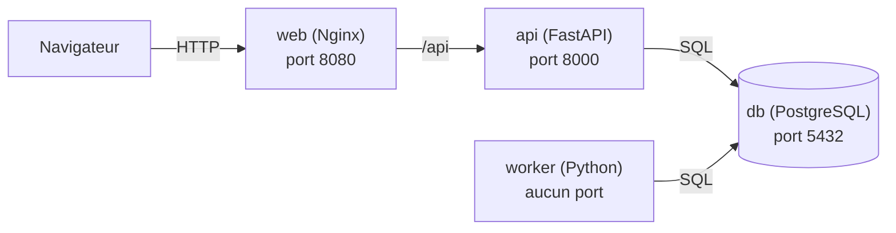
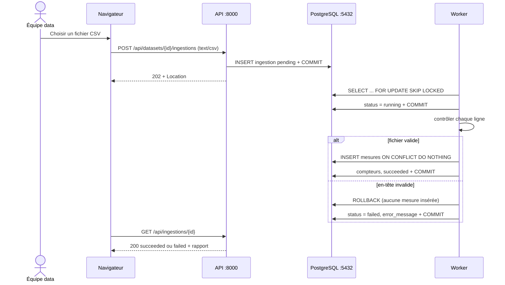
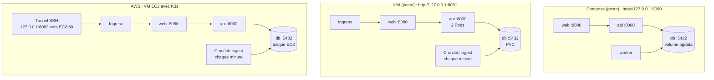

# Dossier de conception - équipe à renseigner

**Membres :** Karelle-koulibaly (projet solo). **Version du dossier / commit :** S1, commit à renseigner après `git commit`.
**Date de revue :** 17/11/2026. **Relecteur :** à renseigner (revue croisée, tâche 8).


Cette trame se complète dès S1 puis évolue avec les décisions réellement prises.
Remplacer les consignes par vos réponses ; conserver les limites utiles.
Ne pas recopier tout l’énoncé : expliquer son application à votre réalisation.

## 1. Besoin et utilisateurs

Rédiger cinq phrases : utilisateur, problème, action principale, donnée durable,
limite du prototype. Décrire ensuite un parcours de démonstration et un cas d’erreur.
Préciser que le responsable déclaré n’est pas un compte authentifié.

1. L'équipe data du campus utilise l'application.
2. Aujourd'hui, les CSV des capteurs sont recopiés à la main dans un tableur, ce qui crée des erreurs et des doublons.
3. Elle dépose un fichier CSV et consulte le rapport de traitement et les indicateurs par salle.
4. On conserve les jeux de données, l'historique des dépôts et les mesures (salle, date, CO₂, température, humidité).
5. Sont exclus : connexion utilisateur, IA, temps réel.

**Scénario de démo :** ouvrir l'appli vide → créer un jeu → déposer `mesures-salles-2026-10-05.csv` → attendre `succeeded` (63 acceptées) → lire les indicateurs → redéposer le fichier (0 acceptée, 63 doublons).

**Cas d'erreur :** déposer `en-tete-invalide.csv` → `failed`, « Invalid header ».

## 2. Backlog et critères d’acceptation

| ID | En tant que… je veux… afin de… | Priorité | Étant donné / Quand / Alors | Cas d'erreur | Responsable | Test/preuve |
|---|---|---|---|---|---|---|
| US01 | créer un jeu de données | Haute | Étant donné aucun jeu « salle-A », quand je le crée, alors l'API répond 201 et il apparaît dans la liste | Nom déjà utilisé : 409 | Moi | à venir en S2 |
| US02 | lister et ouvrir les jeux | Haute | Étant donné un jeu de 63 mesures, quand j'ouvre la liste, alors je vois « 63 mesures » | Id inconnu : 404 | Moi | à venir en S2 |
| US03 | supprimer un jeu | Moyenne | Étant donné un jeu avec des mesures, quand je confirme, alors le jeu et ses mesures sont supprimés | Si j'annule, aucune requête n'est envoyée | Moi | à venir en S2 |
| US04 | déposer un fichier CSV | Haute | Étant donné un jeu vide, quand je dépose le fichier de référence, alors l'API répond 202 et le dépôt est pending |Fichier vide : 422 Empty file, aucun dépôt créé | Moi | à venir en S2 |
| US05 | voir mon dépôt traité | Haute | Étant donné un dépôt pending, quand le worker l'a traité, alors il est succeeded (63 acceptées, 0 rejetée, 0 doublon) | en-tete-invalide.csv : failed, « Invalid header », 0 mesure | Moi | à venir en S2 |
| US06 | voir les lignes rejetées | Haute | Étant donné mesures-avec-erreurs.csv, alors 4 acceptées, 7 rejetées, chacune avec sa raison | co2_ppm = abc : ligne rejetée et comptée, le dépôt continue | Moi | à venir en S2 |
| US07 | redéposer sans doublon | Haute | Étant donné un jeu de 63 mesures, quand je redépose le même fichier, alors 0 acceptée, 63 doublons, toujours 63 mesures | Un doublon est ignoré et compté, jamais une erreur | Moi | à venir en S2 |
| US08 | consulter les indicateurs | Moyenne | Étant donné plusieurs salles, quand je filtre salle et période, alors je vois moyenne, min, max | Période sans mesure : liste vide ; date invalide : 422 | Moi | à venir en S2 |
| US09 | relancer un dépôt échoué | Basse | Étant donné un dépôt failed, quand je le relance, alors il repasse à pending | Dépôt succeeded : 409 | Moi | à venir en S2 |
| US10 | compter sur un service fiable | Moyenne | Étant donné un jeu rempli, quand je redémarre les conteneurs, alors les données sont toujours là | Base indisponible : 503 | Moi | à venir en S2 |

Pour chaque US, décomposer réalisation, validation et documentation en tâches.
Prévoir un critère négatif lorsqu’il existe un refus attendu. Une tâche n’est
terminée qu’après observation et revue de son résultat.

## 3. Maquettes et interactions

### Écran 1 : jeux de données

```
CampusData                                         Version : abc123

Nouveau jeu de données
Nom*         [____________________]   (3 à 120 caractères)
Description  [____________________]
Responsable  [Équipe______]   [ Créer ]    <message de résultat / erreur>

Jeux de données
Nom                    Responsable   Mesures   Créé le
Qualité air - bât. A   Équipe A          63    2026-11-16   [Ouvrir] [Supprimer]
```

| État | Ce que l'utilisateur voit |
|---|---|
| Chargement | « Chargement des jeux… », bouton Créer actif |
| Liste vide | « Aucun jeu de données. Créez-en un ci-dessus. » |
| Données visibles | Tableau avec nom, responsable, nombre de mesures, date |
| Erreur | « Impossible de charger les jeux (service indisponible). » + bouton Réessayer |

Messages du formulaire : 409 → « Ce nom est déjà utilisé » ; 422 → « Nom trop court (3 caractères minimum) ». Après un échec, les champs saisis restent remplis. Pendant l'envoi, le bouton Créer est désactivé, puis réactivé dans un `finally`.
Suppression : une confirmation affiche le nom du jeu et le nombre de mesures supprimées avec lui. Si j'annule, aucune requête n'est envoyée.

### Écran 2 : un jeu, ses dépôts et ses indicateurs

```
Qualité air - bât. A                                  63 mesures

Déposer un fichier CSV   [ Choisir un fichier ] [ Déposer ]
Dépôts   [ Tous les statuts v ] [ Actualiser ]
Fichier                    Statut      Acceptées Rejetées Doublons  Déposé à
mesures-avec-erreurs.csv   succeeded          4        7        1   10:42  [Rapport]
en-tete-invalide.csv       failed             -        -        -   10:40  [Relancer]

Indicateurs   Salle [toutes v]  Du [____]  Au [____]  [Filtrer]
Salle  Mesures  CO₂ moy.  CO₂ min  CO₂ max  Temp. moy.  Hum. moy.  Dernière mesure
A101       21     636.1      430     1092      20.3        44.2     05/10 18:00
```

| Liste | Chargement | Vide | Données visibles | Erreur |
|---|---|---|---|---|
| Dépôts | « Chargement des dépôts… » | « Aucun dépôt. Déposez un CSV. » | Tableau ci-dessus | « Erreur de chargement » + Réessayer |
| Indicateurs | « Calcul… » | « Aucune mesure pour ce filtre. » | Tableau par salle | « Période invalide (Du doit précéder Au) » ou « Service indisponible » |

Un dépôt accepté affiche d'abord `pending` : 202 signifie « reçu », pas « traité ». L'interface interroge le statut toutes les 2 s, au plus 60 fois, jusqu'à `succeeded` ou `failed`.
Accessibilité : chaque champ a un `<label>`, les boutons sont utilisables au clavier, les tableaux ont un `<caption>` et des `<th scope="col">`. Les valeurs sont affichées avec `textContent`, jamais `innerHTML`.

## 4. Architecture et flux

Produire les diagrammes de composants, séquence de création et déploiement.
Ajouter une séquence de refus de transition avec l’emplacement du **rollback**.
Indiquer les ports, noms réseau, frontières poste/conteneur/VM et **stockage durable**.

| Contexte | Point d'entrée utilisateur | Accès API | Accès DB depuis API | Lieu du stockage |
|---|---|---|---|---|
| Développement | http://127.0.0.1:8080 (interface) | http://127.0.0.1:8000 | 127.0.0.1:5433 (port publié, 5432 déjà occupé). | volume Docker pgdata |
| Compose | http://127.0.0.1:8090 (port changé, 8080 pris par Spark) | via web, api:8000 | db:5432 | volume pgdata |
| k3d | http://127.0.0.1:8081 | à relever (S4) | à relever (S4) | à relever (S4) |
| AWS/K3s | http://127.0.0.1:8082 (tunnel SSH) | à relever (S5) | à relever (S5) | à relever (S5) |


Seul `web` est accessible depuis le navigateur. `api` et `db` restent internes. Le worker n'écoute rien : il interroge la base.


Le **rollback** a lieu dans le traitement du worker : il annule toute l'insertion de la transaction 2. Un dépôt `failed` n'a donc jamais de mesures partielles.




## 5. Données et contrat

Présenter le dictionnaire des trois tables (datasets, ingestions, measurements),
types, **contraintes SQL**, clés étrangères et **valeurs par défaut**. Expliquer qui
produit UUID et **horodatages**, quelles valeurs peuvent être nulles, et quelle
contrainte d’unicité rend l’ingestion idempotente.

### Dictionnaire des tables

**datasets**

| Colonne | Type | Obligatoire | Contrainte / défaut |
|---|---|---|---|
| id | UUID | oui | PK, UUID v4 généré par le serveur |
| name | VARCHAR(120) | oui | UNIQUE, 3 à 120 caractères, espaces externes retirés |
| description | TEXT | non | max 2 000 caractères, défaut null |
| owner | VARCHAR(60) | oui | 2 à 60 caractères, défaut « Équipe » |
| created_at | TIMESTAMPTZ | oui | posé par le serveur, UTC, immuable |

`measurement_count` est calculé, pas stocké.

**ingestions**

| Colonne | Type | Obligatoire | Contrainte / défaut |
|---|---|---|---|
| id | UUID | oui | PK, généré par le serveur |
| dataset_id | UUID | oui | FK → datasets.id, ON DELETE CASCADE |
| filename | VARCHAR(255) | oui | 1 à 255 caractères, sans / ni \ |
| status | VARCHAR(10) | oui | pending, running, succeeded, failed ; défaut pending |
| content | BYTEA | oui | fichier brut ≤ 1 Mio, jamais renvoyé par l'API |
| rows_total, rows_accepted, rows_rejected, rows_duplicate | INTEGER | non | null jusqu'au traitement |
| errors | JSONB | oui | max 20 objets {line, reason}, défaut [] |
| error_message | TEXT | non | cause d'un échec, défaut null |
| created_at | TIMESTAMPTZ | oui | date du dépôt |
| started_at, finished_at | TIMESTAMPTZ | non | posés par le worker, null à la création |

Invariant d'un dépôt réussi : rows_total = rows_accepted + rows_rejected + rows_duplicate.

**measurements**

| Colonne | Type | Obligatoire | Contrainte |
|---|---|---|---|
| id | BIGINT identité | oui | PK technique |
| dataset_id | UUID | oui | FK, ON DELETE CASCADE |
| ingestion_id | UUID | oui | FK, ON DELETE CASCADE |
| room | VARCHAR(30) | oui | 1 à 30 caractères |
| measured_at | TIMESTAMPTZ | oui | instant avec fuseau |
| co2_ppm | INTEGER | oui | CHECK 250 à 10 000 |
| temperature_c | NUMERIC(4,1) | oui | CHECK -30 à 60 |
| humidity_pct | NUMERIC(4,1) | oui | CHECK 0 à 100 |

**Unicité :** `UNIQUE (dataset_id, room, measured_at)` rend l'ingestion idempotente : une même mesure ne peut exister qu'une fois par jeu, même si le fichier est déposé deux fois.
**Index :** `ingestions (status, created_at)` pour que le worker trouve vite les dépôts en attente (coût : un peu plus lent à l'écriture).
**Qui produit quoi :** le serveur génère les UUID et `created_at` ; le worker pose `started_at` et `finished_at`.

| Champ | Exemple valide | Exemple invalide |
|---|---|---|
| co2_ppm | 712 | abc, ou 100 (< 250) |
| temperature_c | 20.8 | 75 (> 60), ou « chaud » |
| humidity_pct | 46.3 | 120 (> 100), ou -5 |

### Trois cas à ne pas confondre

| Cas | Exemple | Résultat |
|---|---|---|
| Ligne invalide | co2_ppm = abc | ligne rejetée et comptée, le dépôt continue |
| Fichier invalide | en-tête faux | dépôt failed, aucune mesure insérée |
| Doublon | même salle, même heure | ligne ignorée et comptée, pas une erreur |

### Statuts d'un dépôt

| Statut courant | Événement | Nouveau statut | Qui | Réponse |
|---|---|---|---|---|
| - | Dépôt d'un fichier | pending | API | 202 |
| pending | Prise en charge | running | Worker | - |
| running | Traitement terminé | succeeded | Worker | - |
| running | Fichier refusé ou exception | failed | Worker | - |
| failed | Relance | pending | API | 200 |
| pending, running, succeeded | Relance | inchangé | API | 409 |

### Contrôles d'une ligne CSV (dans cet ordre)

1. Exactement 5 colonnes → `Expected 5 columns`
2. room de 1 à 30 caractères → `Invalid room`
3. measured_at en ISO 8601 avec fuseau → `Invalid measured_at`
4. measured_at au plus 5 min dans le futur → `measured_at in the future`
5. co2_ppm entier 250 à 10 000 → `Invalid co2_ppm`
6. temperature_c entre -30 et 60 → `Invalid temperature_c`
7. humidity_pct entre 0 et 100 → `Invalid humidity_pct`

### Routes

| Méthode | Route | Entrée | Succès | Erreurs |
|---|---|---|---|---|
| GET | /api/datasets | - | 200, liste | 503 |
| POST | /api/datasets | JSON {name, description?, owner?} | 201 | 422, 409, 503 |
| GET | /api/datasets/{id} | UUID | 200 | 422, 404, 503 |
| DELETE | /api/datasets/{id} | UUID | 204 sans corps | 422, 404, 503 |
| POST | /api/datasets/{id}/ingestions?filename=… | corps text/csv | 202 + en-tête Location | 415, 413, 422, 404, 503 |
| GET | /api/datasets/{id}/ingestions | status? | 200 | 422, 404, 503 |
| GET | /api/ingestions/{id} | UUID | 200 | 422, 404, 503 |
| POST | /api/ingestions/{id}/retry | - | 200, repasse à pending | 422, 404, 409, 503 |
| GET | /api/datasets/{id}/stats | room?, from?, to? | 200 | 422, 404, 503 |
| GET | /api/version | - | 200 | - |
| GET | /health/live | - | 200 | - |
| GET | /health/ready | - | 200 | 503 |

### Codes d'erreur

- **404** : UUID valide mais jeu ou dépôt inconnu.
- **409** : nom de jeu déjà utilisé, ou relance d'un dépôt qui n'est pas `failed`.
- **413** : fichier de plus de 1 Mio.
- **415** : Content-Type différent de text/csv.
- **422** : entrée non conforme (nom trop court, UUID mal formé), corps vide (`Empty file`), période invalide (from ≥ to).
- **503** : PostgreSQL injoignable (`Database unavailable`).
- **500** : erreur inattendue, message générique, trace seulement dans les logs.

Ordre d'évaluation : validation (422, 415, 413), puis recherche (404), puis règle métier (409), puis enregistrement.

### Exemples HTTP

**1. Créer un jeu → 201**
```
POST /api/datasets
Content-Type: application/json

{"name": "Qualité de l'air - bâtiment A", "owner": "Équipe A"}

→ 201 Created
{"id": "6b1e7c0a-3f4d-4d0e-9a51-2d8f0c7a1b23", "name": "Qualité de l'air - bâtiment A",
 "description": null, "owner": "Équipe A",
 "created_at": "2026-11-16T10:00:00Z", "measurement_count": 0}
```

**2. Déposer un fichier → 202**
```
POST /api/datasets/6b1e7c0a-3f4d-4d0e-9a51-2d8f0c7a1b23/ingestions?filename=mesures-avec-erreurs.csv
Content-Type: text/csv

room,measured_at,co2_ppm,temperature_c,humidity_pct
A101,2026-10-06T08:00:00+02:00,455,19.6,43.0
…

→ 202 Accepted
Location: /api/ingestions/1d9c4f2e-8b7a-4c61-9e0d-5a3b2c1d0e9f
{"id": "1d9c4f2e-…", "status": "pending", "filename": "mesures-avec-erreurs.csv", …}
```

**3. Lire un dépôt traité → 200**
```
GET /api/ingestions/1d9c4f2e-8b7a-4c61-9e0d-5a3b2c1d0e9f

→ 200 OK
{"id": "1d9c4f2e-…", "status": "succeeded", "rows_total": 12, "rows_accepted": 4,
 "rows_rejected": 7, "rows_duplicate": 1,
 "errors": [{"line": 5, "reason": "Invalid co2_ppm"}, …],
 "error_message": null, "finished_at": "2026-11-16T10:42:03Z"}
```

**4. Relancer un dépôt réussi → 409**
```
POST /api/ingestions/1d9c4f2e-8b7a-4c61-9e0d-5a3b2c1d0e9f/retry

→ 409 Conflict
{"detail": "Ingestion cannot be retried"}
```
Aucune mutation : le dépôt reste `succeeded`.

**5. Fichier trop volumineux → 413** : `{"detail": "File too large"}`, aucun dépôt créé.
**6. Suppression → 204** : `DELETE /api/datasets/{id}` renvoie 204 sans corps ; les dépôts et mesures sont supprimés (CASCADE).

## 6. Découpage du code et transactions

| Module | Responsabilité | Dépendances | Invariant/commentaire important | Test associé |
|---|---|---|---|---|
| À renseigner | Une responsabilité précise | Modules utilisés | Règle protégée | Scénario |

Préciser le responsable du **commit**, le **rollback**, la fermeture des sessions,
le **verrou de ligne** et la sérialisation. Décrire l’initialisation explicite et
la limite de create_all face à une évolution de schéma.

## 7. Décisions argumentées

| Décision | Option retenue | Alternative étudiée | Motif concret | Conséquence/limite | Preuve ou référence |
|---|---|---|---|---|---|
| Stockage | PostgreSQL partout, y compris pour les dépôts en attente | Fichier ou file en mémoire | Une seule source durable : les dépôts pending survivent à un redémarrage | La base devient un point unique de panne | Test de persistance en S3 |
| Traitement | Worker séparé | Traiter le CSV dans la requête HTTP | L'API répond 202 tout de suite, même pour un gros fichier | Il faut un statut pending / succeeded / failed | Séquence de dépôt (§4) |
| Doublons | Contrainte d'unicité (salle + heure) | Vérifier en code avant d'insérer | La base garantit l'idempotence même en cas de traitement concurrent | Un doublon est compté, pas une erreur | Redépôt du fichier : 0 acceptée, 63 doublons |

Une préférence seule ne justifie pas un choix. Relier la décision au temps,
au contrat, à la reproductibilité ou au comportement observé.

## 8. Risques et mesures

| Risque | Effet utilisateur | Détection | Mesure prévue | Limite restante |
|---|---|---|---|---|
| Panne API | À compléter | À compléter | À compléter | À compléter |
| Panne DB | À compléter | À compléter | À compléter | À compléter |
| Perte du nœud | À compléter | À compléter | À compléter | À compléter |
| **Secret** exposé | À compléter | À compléter | À compléter | À compléter |
| Ressource cloud oubliée | À compléter | À compléter | À compléter | À compléter |

## 9. Validation croisée

Noter qui a relu le dossier, quelles ambiguïtés ont été trouvées et corrigées.
Identifier les différences entre conception initiale et réalisation finale.
Conserver les questions non résolues et leurs effets, sans les présenter comme validées.

## Exemple de justification à adapter

**Exemple de forme, à relier à votre réalisation :** « Nous utilisons une session
par requête pour séparer les transactions des utilisateurs. La dépendance ferme
la session même si une erreur remonte. Nous vérifions que l’ingestion est
idempotente en redéposant le même fichier puis en relisant le nombre de mesures. »

Ajoutez le nom de votre module, le test correspondant et la limite observée.
Ne reprenez pas cette explication si votre implémentation utilise une autre
organisation : décrivez alors son fonctionnement réel.
